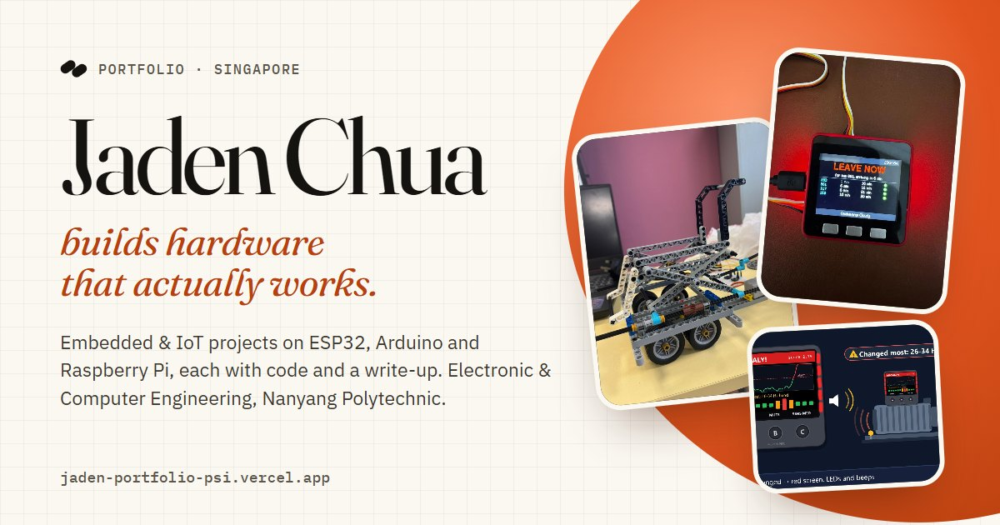

# Jaden Chua · Portfolio

**Live: [jaden-portfolio-psi.vercel.app](https://jaden-portfolio-psi.vercel.app/)** · [Résumé](https://jaden-portfolio-psi.vercel.app/resume.html)

Personal portfolio site for Jaden Chua, Electronic and Computer Engineering student at Nanyang Polytechnic, Singapore.



## Projects on the site

| # | Project | Code |
|---|---|---|
| 01 | M5Stack self-watering garden monitor ([try its dashboard](https://jaden-portfolio-psi.vercel.app/demos/garden/)) | [m5stack-garden-monitor](https://github.com/jadenchua-dot/m5stack-garden-monitor) |
| 02 | Equipment levelling monitor ([try its dashboard](https://jaden-portfolio-psi.vercel.app/demos/tilt/)) | [m5stack-fire-tilt-sensor](https://github.com/jadenchua-dot/m5stack-fire-tilt-sensor) |
| 03 | TinyML vibration anomaly detector | [m5stack-tinyml-vibration](https://github.com/jadenchua-dot/m5stack-tinyml-vibration) |
| 04 | ExitPilot: when to leave for the bus | [m5stack-exitpilot](https://github.com/jadenchua-dot/m5stack-exitpilot) |
| 05 | Smart Window Energy Guard | [iot-window-energy-monitor](https://github.com/jadenchua-dot/iot-window-energy-monitor) |
| 06 | Smart elevating wheelchair (team of 4) | [smart-elevating-wheelchair](https://github.com/jadenchua-dot/smart-elevating-wheelchair) |
| 07 | SafeLens AI, GovTech Digital4Good hackathon ([live demo](https://jadenchua-dot.github.io/Safe-Lens-AI/)) | [Safe-Lens-AI](https://github.com/jadenchua-dot/Safe-Lens-AI) |
| 08 | ATmega328P embedded C labs | [MicroController-embedded-system](https://github.com/jadenchua-dot/MicroController-embedded-system) |
| 09 | Fast food ordering system | [python-terminal-shop](https://github.com/jadenchua-dot/python-terminal-shop) |
| 10 | Pokémon card portfolio tracker | [collectr-portfolio-tracker](https://github.com/jadenchua-dot/collectr-portfolio-tracker) |

## What's on the page

- **Laptop intro:** the site starts on a tilted laptop screen and zooms to fill the window as you scroll.
- **Project write-ups:** each with a wiring diagram that draws itself in, measured values, a build log and "what broke, and the fix".
- **Project map:** an isometric town with one block per project; pins jump to the write-up.
- **Live device demos:** the tilt and garden monitors' own dashboards running on simulated sensors (see below).
- **Search:** press <kbd>Ctrl</kbd> <kbd>K</kbd> (<kbd>⌘</kbd> <kbd>K</kbd> on a Mac) or <kbd>/</kbd> to jump to any project or section, switch theme, copy the email address or open the résumé.
- **Résumé:** a one-page A4 résumé at `/resume.html`, with a PDF download.
- **Footer:** the current time in Singapore and the latest commit on GitHub (live from the GitHub API, cached for 15 minutes, with a plain link if the API is unreachable).
- **Light and dark mode**, scroll animations that respect *reduce motion*, and a custom cursor on mouse devices.

## Files

```text
index.html                 the whole site: inline CSS, SVG diagrams and scripts, no build step
resume.html                one-page résumé (prints to a single A4 page)
demos/tilt/index.html      the tilt monitor's dashboard + a simulated device
demos/garden/index.html    the garden monitor's dashboard + a simulated garden
404.html                   "page not found"
assets/                    photos, videos, the résumé PDF, share image and icons
vercel.json                security headers and caching for assets
robots.txt, sitemap.xml, site.webmanifest, favicon.svg, favicon.ico
```

## How the device demos work

Each demo is the device's own web page, copied unchanged out of its firmware (`include/web_page.h` in the tilt repo, `PAGE` in `garden_monitor_wifi.ino`), with two additions marked `DEMO` in the HTML:

1. A small script that replaces `fetch()` for the page's API calls (`/api/status`, `/api/zero`, `/api/limit`, `/api/mute` and `/data`) and answers them with a simulated device that follows the firmware's rules: the tilt alarm's 0.5 s delay and 1.5° hysteresis, the garden's five dry readings, tank and humidity checks, 5 s watering and 60 s cooldown.
2. A control strip at the top: drag to tilt (or use your phone's motion sensor), bump it, dry out the soil, empty the tank, make it a humid day.

If a dashboard changes in the firmware, copy the new page between the markers and keep the two `DEMO` blocks.

## Résumé PDF

`assets/Jaden-Chua-Resume.pdf` is `resume.html` saved as a PDF. After editing the résumé, open it in Chrome or Edge, press **Print**, choose **Save as PDF**, paper size **A4**, margins **Default**, and replace the file.

## Run locally

Serve the folder so the demo links work:

```bash
python -m http.server 8000
```

Then open <http://localhost:8000>.

## Deploy

Hosted on Vercel: import this repository, keep the default settings (Framework Preset: Other, no build command), and deploy. Every push to `main` redeploys the site; pull requests get a preview deployment.
